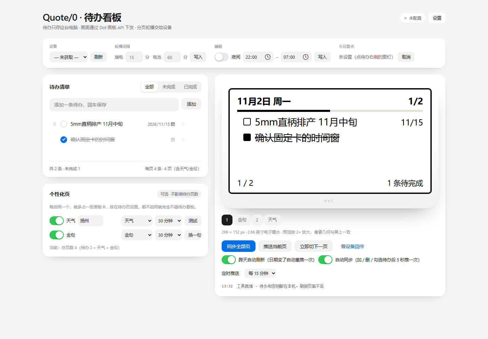
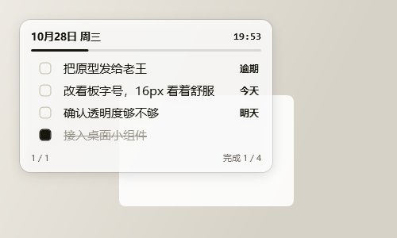
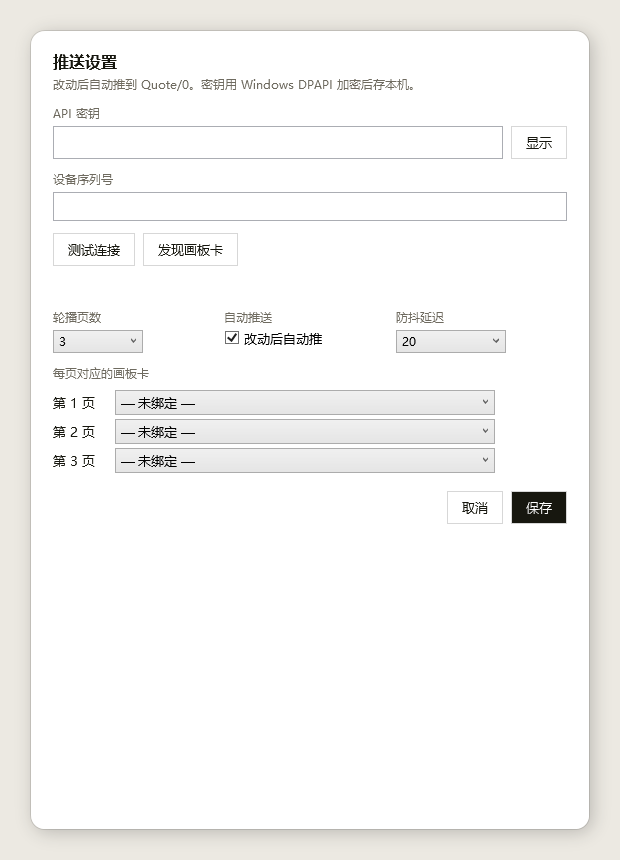
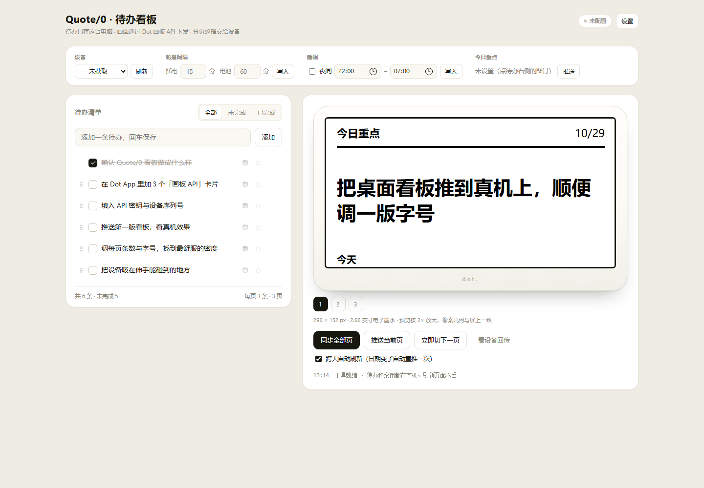
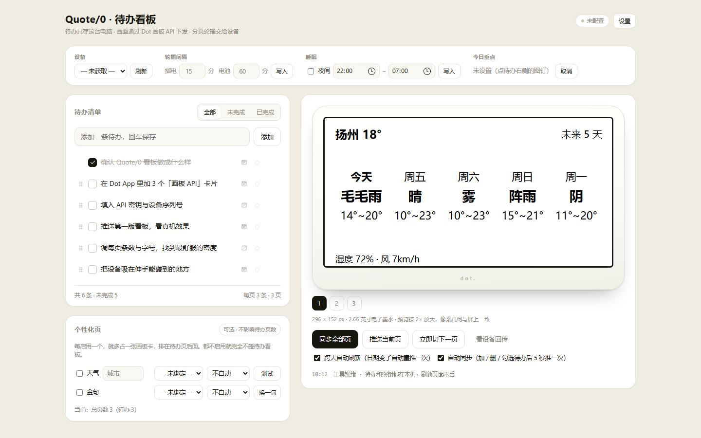

# Quote/0 待办看板

把 Quote/0 变成一块待办看板：左边改待办，右边是 1:1 的 Quote/0 仿真预览，点一下同步就推到真机。待办多了一屏放不下，就分成多页，交给设备的循环列表自己轮播。

单文件、零依赖、零安装：双击 `Quote0-待办看板.html` 就能用。待办和密钥都只存在你自己浏览器的 localStorage 里，不会上传到任何地方，也不会写进这个文件。



项目分两部分：

- **网页版**：一个 HTML 文件，负责编辑待办、1:1 预览、推送到设备，还带天气/金句页和轮播设置。
- **桌面版**：Windows 透明置顶小组件（WPF，单文件 exe），负责常驻显示和自动推送。

## 桌面版

双击 `QuoteTodo.exe`：一张半透明磨砂卡片浮在桌面右上角，无边框、不占任务栏、始终置顶。

| 操作 | 说明 |
|---|---|
| 按住卡片拖 | 移动，松手记住位置 |
| 点左边的方块 | 勾掉 / 取消一条（热区 30×28，不用瞄准那个小方框） |
| 滚轮 | 条数超过一屏时翻页 |
| 右键卡片 | 新增、从网页版导入、每页条数、透明度、点击穿透、开机自启、退出 |
| `Ctrl+Alt+L` | 切「点击穿透」——穿透后点它等于点底下的窗口，托盘可切回 |
| 托盘图标 | Windows 10 默认把新图标收进 `^` 溢出区，点开可以拖到底栏常驻 |
| 关窗口 | 直接退出（不藏进托盘，避免找不回来） |

- 数据在 `%APPDATA%\Quote0Todo\todos.json`；设了环境变量 `QUOTETODO_HOME` 就存到那里（绿色版）
- 首次启动带 4 条示例，右键「从网页版导入」换成你真实的清单（先在网页版点导出）
- 启动或运行出错会写 `error.log` 到同一目录
- 源码 `src/QuoteTodo.cs`，改完运行 `build.ps1` 重新编译



## 自动推送

右键卡片 →「推送设置…」：

1. 填 **API 密钥**（可用「显示」核对）和**设备序列号**
2. 点「发现画板卡」——工具读一次循环列表，把里面的「画板 API」卡片按顺序填到第 1…N 页
3. 设定轮播页数、是否自动推、防抖延迟（10/20/30/60 秒）
4. 保存

之后你每勾一条、加一条、删一条，都会在**最后一次改动后 N 秒**把全部页推一遍（防抖，不会连续打接口）。也可以右键「立即推送到 Quote/0」手动推一次。

- 密钥用 Windows DPAPI 加密后存进 `todos.json`，不落明文
- 推送走的是和网页版**完全相同**的画板结构（我做过逐节点比对，0 差异），所以真机排版和你验收过的一致
- 失败会在托盘气泡里给原因：密钥无效 / 无权限 / 循环列表没有画板卡 / 设备离线



## 它长什么样

- 屏幕按真机 296 × 152 px 的几何渲染，再放大 2 倍给你看，所以排版不会「预览一套、真机一套」。
- 预览用的元素树，和真正下发给设备的是**同一棵树**（Dot 画板 API 的 `windowData`），改一行两边一起变。
- 页眉左边是日期，右边是「完成数/总数」；下面一条进度条，中间是待办（勾选框 + 标题 + 截止日），底部是页码和剩余条数。
- 截止日里「今天 / 明天 / 逾期」加粗显示，具体日期用数字（`11/3`）。**屏上没有灰色小字**——1-bit 墨水屏会把灰色抖成噪点，小字号直接糊掉，所以需要读的字一律纯黑。
- **字号跟着每页条数走**：2 条用 18px，3 条用 16px，4 条用 14px。条数越少字越大，默认 3 条。
- 已完成自动沉到最后一页，**黑字 + 删除线 + 实心勾选框**。不用灰色：1-bit 屏把灰抖成稀疏点阵，小字号会直接消失（「明天」两个字当初就是这么没的）。
- 加 / 删 / 勾选待办后，默认 **5 秒后自动同步一次**（防抖，连改几条只推一次）。预览区下方可关。
- 另有**定时推送**：默认每 30 分钟把全部页重推一次（可选 15 分钟 / 30 分钟 / 1 小时 / 关）。页面开着才生效；刚推过 2 分钟内不会再插一次。

## 为什么屏上没有时钟

画板 API 读不到设备自己的时钟，只能把**下发那一刻**的时间画进画面。那个数字不会走，放了反而误导，所以已经去掉 —— 右上角改成显示 `完成数/总数`，底部显示还剩几条。

桌面卡片上那个时间是真的会走的（每 10 秒刷），两者不是一回事。网页版设置里还留着「右上角显示时间」的开关，默认关闭；真想要静态时间戳可以自己打开。

## 上手三步

1. **拿密钥和设备号**
   Dot App → 我的 → 开放 API → 获取密钥（形如 `dot_app_...`）；设备序列号在设备详情里（形如 `ABCD1234ABCD`）。
   官方文档：<https://dot.mindreset.tech/docs/service/studio/api/get_api>

2. **在 App 里加「画板 API」卡片**
   内容工坊 → 选中这台设备 → **循环列表** → 添加「画板 API」。
   **要几页就加几个**（默认 3 页就加 3 个）。这一步不能省，否则 API 会返回 404。

3. **填进去、绑定、同步**
   点右上角「设置」→ 填密钥和设备号 → 「发现画板卡」（自动按顺序绑到第 1–N 页）→ 保存 → 「同步全部页」。

## 轮播是怎么来的

Quote/0 的循环列表会按你设的间隔（1 分钟 ~ 12 小时）依次切换列表里的卡片。所以「轮播」不是这个工具在定时推，而是**工具把每一页分别写进一个画板卡，设备自己转**。工具关了也照样轮。

## 主页的控制条

页面顶部一条，不用进设置：

| 位置 | 作用 |
|---|---|
| 设备 | 从账号里拉设备列表（`GET /devices`），切换后自动重新发现画板卡 |
| 轮播间隔 | 插电 / 电池 分钟数（1–720），写入设备 |
| 睡眠 | 夜间开关 + 起止时间，写入设备 |
| 今日重点 | 当前钉住哪条 + 「推送」到固定卡 |
| 预览区下方 | 同步全部页、推送当前页、**立即切下一页**（`POST /next`）、看设备回传、**跨天自动刷新** |

「立即切下一页」要求设备接着电才生效；「跨天自动刷新」每分钟检查一次，日期变了就静默重推一遍（一天最多一次，几乎不耗电）。

## 今日重点（置顶）

在待办行右侧点一下空心圆 `○`，它变成实心 `●`，这条就**置顶**：永远排在轮播第一页的第一行，左边多一道黑条标记。轮播照转，重点一眼能看到。

再点一次 `●` 或者在控制条点「取消」就取消置顶。**不需要**固定卡，也不会影响轮播。

### 固定卡（高级，慎用）

设置面板里还有一个「把今日重点推到固定卡」——它占用**固定列表**里的画板卡，写一张大字卡：



注意这套机制是"按时间窗覆盖"，不是"切过去"：

- 固定卡只在它自己的**时间窗**内显示；窗口之外设备自动回轮播
- 如果时间窗设成全天（00:00–23:59），**轮播会被一直压住**，屏上只显示固定卡
- 想立刻回轮播：去 Dot App → 内容工坊 → 固定列表 → 改/关时间窗，或删掉这张卡
- 工具里「取消置顶」只停止继续推，不会把屏从固定卡拉回来
- 固定卡的时间设置 **API 改不了**（`/settings` 只管 interval / sleep / alias / timezone）

所以日常用「置顶」，固定卡留给「每天 9:00–9:30 只看那一件事」这种短时窗场景。

## 天气页 / 金句页

设置 → 附加页：勾选、填城市、绑画板卡。它们是**正式的轮播页**——占一张画板卡，出现在页面顶部的页签里，预览、推送、页脚编号（`3 / 5`）都跟待办页一样，不再是一个单独的推送动作。页面上的页签顺序按画板卡在循环列表里的真实位置排，所以预览顺序 = 设备轮播顺序。

 

- **天气**走 Open-Meteo，免 API key，浏览器直连（已验证 `file://` 下跨域可用）。版式是**横向 5 列**：顶部城市 + 当前温度，下面一行 5 个日期（今天 / 周五 / …），每列天气 + 最低~最高，底部湿度风速 + **数据更新时间**。
  - 刷新默认**每天一次**（可选 1 小时 / 3 小时 / 每天 / 不自动）。页面开着才会按点刷，关掉就停在上次。
  - 卡底的 `更新 11/4 08:30` 是抓数据的时间 —— 看到旧时间就说明卡没刷新。
  - Open-Meteo 的中文地名库不全：「扬州」查不到、「扬州市」才有。工具会自动补一个「市」再试，仍找不到就试拼音（如 `yangzhou`）。
- **金句**是本地清单（**100 条，全部出自《毛泽东选集》一至四卷**，按篇目分组并注明出处），不依赖网络。「自动换句」可选 30 分钟 / 1 小时 / 3 小时 / 每天，也可以点「换一句」立刻推一条。要换成别的清单，改 `Quote0-待办看板.html` 里的 `QUOTES` 数组即可。

两个都要**各占一个画板卡**：App 的循环列表里要相应多加卡片，再在设置里分别绑定。自动换句依赖这个页面开着，页面关了就停在最后一句。

**页数怎么算**：设置里的「待办页数」只数待办页，**总页数 = 待办页数 + 天气 + 金句**。比如 3 个待办页 + 天气 + 金句 = 5 张卡，那就在 App 里建 5 个画板卡、待办页数填 3。设置里会实时显示「总页数 5（待办 3 + 天气 + 金句）」，页签也会是 5 个。

> 在设置里**选了画板卡就会自动勾上启用**——之前"绑了卡但忘了勾启用"会导致推送时被跳过。现在每次同步都会在日志里写一行 `天气页 ✓ 北京 16°`，失败也会写明原因（没绑卡 / 没填城市 / 拉取失败 / 接口报错）。

## 在工具里改轮播间隔

主页控制条 → 填「插电 / 电池」的分钟数 → 「写入」。打开页面时会静默读一次设备现值并回填。

走的是设备设置 API：

```
GET  /api/authV2/open/device/{deviceId}/settings
POST /api/authV2/open/device/{deviceId}/settings
{ "interval": { "powerMs": 900000, "batteryMs": 3600000 } }
```

几个要注意的：

- 这是**设备级**设置，同样影响固定内容和其他卡片，不只这个看板
- 接口单位是毫秒、且必须是 60000 的倍数，工具里填分钟，已经换算好
- Quote/0 的自动切换范围是 **1 分钟 ~ 12 小时**（插电/电池都一样），超范围服务端会拒
- 主动刷新（`refreshNow`）不受这个间隔限制

## 已知边界

| 事项 | 说明 |
|---|---|
| 每页条数 | 2 / 3 / 4 条，对应标题 18 / 16 / 14 px。嫌字小就选 3 条或 2 条，页面会变大、总容量变小。 |
| 时钟 | 屏上没有时钟。画板 API 读不到设备时间，只能把下发那一刻画进去，放着会误导，所以去掉了（右上角改成完成数/总数）。 |
| 总容量 | 页数 × 每页条数。超出的条目工具会提示「还有 N 条没排上屏」。 |
| 预览字形 | 几何、字号、颜色一致；但字形用你电脑的系统字体近似，设备上用的是 ChillDuanSans，断行/省略号位置可能差一两个字。想看真机效果点「看设备回传」。 |
| 立即刷新 | 设备**接电源**时 `refreshNow` 才能立刻切画面；用电池时内容先存云端，等设备下次自己醒来才显示。 |
| 频率 | 官方限流 10 次/秒，工具每页之间留了 180ms，正常用碰不到。 |
| 碰一碰 | 没有设置 NFC 跳转链接。 |

## 出错了看这里

| 现象 | 原因 / 处理 |
|---|---|
| 401 | 密钥无效或过期，去 App 重新取一个。 |
| 403 | 这个密钥没有该设备的权限，确认设备号填的是自己账号下的。 |
| 404 | 循环列表里没有「画板 API」卡片，或绑定的 taskKey 对不上。回 App 加卡片，再点「发现画板卡」。 |
| 400 | 参数被拒，日志里会带服务端原话。 |
| 500 | 设备没接电/离线/正在更新，等一会儿重试。 |
| 推送成功但屏幕没变 | 多半是电池供电在睡眠，或循环间隔还没到。接上电源再推一次。 |

## 数据

- 待办：`localStorage["q0board.todos.v1"]`
- 设置（含密钥）：`localStorage["q0board.settings.v1"]`
- **「导出 JSON」现在是完整备份**：待办 + 全部设置（含 API 密钥、设备号、页数、绑定）。换电脑、或担心浏览器清数据，导一份存着；「导入 JSON」会连设置一起恢复。导出文件里有密钥，别随便传人。
- 保存设置时如果浏览器存储不可用（隐私模式、配额满），工具会明确提示，不会再静默丢数据。
- 清空浏览器数据会一起清掉，重要清单先导出。

## 想改样式

屏幕内容全部由文件里的 `buildWindowData()` 生成（搜索 `纯函数区`）。它返回的就是下发给设备的 `windowData`：`div` / `span` 两种元素，`props.tw` 写 Tailwind 类，`props.style` 写内联样式。改完刷新页面，预览立刻变。

几个常用旋钮：

- `PAD_X` / `PAD_Y`：四周留白
- `LAYOUTS`：三套排版。改 `title` 就是改标题字号，改 `rowH` 就是改一行多高。三者 `rowH` 算下来都刚好占满 90px 的列表区，所以 2/3/4 条都会把屏幕填满。
- `font(13)`：页眉的日期和时间；`font(10)`：页脚
- 想更极端一点（比如一屏只放 1 条、字放到 24px），在 `LAYOUTS` 里加个 `1:` 的键，再把设置里的「每页条数」放开到 1 即可。

## 目录结构

```
Quote0-待办看板.html   网页版（单文件，双击即用）
src/QuoteTodo.cs       桌面版源码（WPF，纯 C# 无 XAML）
build.ps1              编译桌面版（csc，.NET Framework 4.8）
docs/                  截图
```

## 构建桌面版

```powershell
powershell -ExecutionPolicy Bypass -File build.ps1
```

输出 `QuoteTodo.exe`（约 60 KB，目标机只需要 .NET Framework 4.8，Windows 10/11 自带）。

## License

MIT

## 参考

- 关于 Quote/0：<https://dot.mindreset.tech/docs/quote_0>
- 画板 API：<https://dot.mindreset.tech/docs/service/open/canvas_api>
- 时间机制（什么情况下不会立刻刷新）：<https://dot.mindreset.tech/docs/quote_0/faq/refresh_timing>
- 列出设备内容：<https://dot.mindreset.tech/docs/service/open/list_device_tasks_api>
